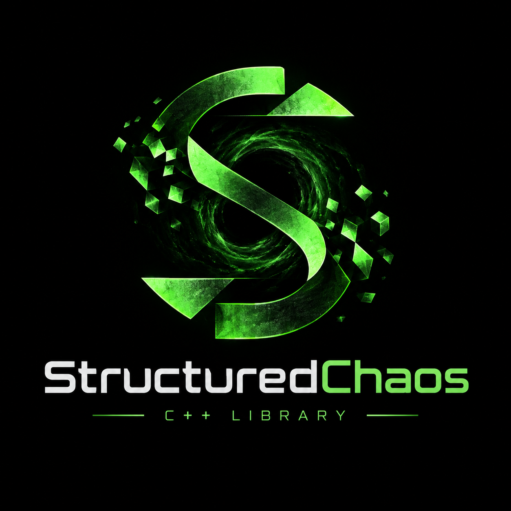

# StructuredChaos

<p align="center">
  
</p>

<p align="center">
  <a href="https://github.com/ReSelution/StructuredChaos/actions/workflows/ci.yml"></a>
  <a href="LICENSE"></a>
  
</p>

A compact C++23 library of building blocks for games and other real-time
applications: an ECS with a system scheduler, a priority thread pool, heap-based memory
management, logging, statistics, localization and hashing.

## Modules

| Module | Header | What it does |
| --- | --- | --- |
| [ECS](#ecs) | `sc/ecs/scheduler.hpp` | Components in index-addressed columns, a scheduler that runs the systems that do not conflict at the same time, and a cache of shared resources |
| [Threading](#threading) | `sc/threading/threading.hpp` | Thread pool with priorities, futures, batches and parallel loops |
| [Memory](#memory) | `sc/memory/heap.hpp` | mimalloc heap that frees everything at once, usable as a `std::pmr` resource |
| [Logger](#logger) | `sc/logger/logger.hpp` | Compile-time named loggers on top of spdlog, one file per module |
| [Stats](#stats) | `sc/stats/stats.hpp` | Counters and throughput meters that compile to nothing when disabled |
| [Localization](#localization) | `sc/localizations/magpie_string.hpp` | *Magpie*: translated strings looked up by a key hashed at compile time |
| [Hash](#hash) | `sc/hash/hash.hpp` | rapidhash with identical results at compile time and at run time |

### ECS

Every component type has a column: the component of an entity lies at the
index of the entity, in address space reserved up front. Getting at one is an
array access, and creating and destroying entities is safe from any thread.
Entities created with the same set of components lie together in the same
pages, so a loop over them touches little memory.

```cpp
#include "sc/ecs/scheduler.hpp"
#include "sc/ecs/world.hpp"
#include "sc/threading/threading.hpp"

using namespace sc::ecs;

struct Position { float x{0.0f}; float y{0.0f}; };
struct Velocity { float dx{0.0f}; float dy{0.0f}; };
struct Health { float value{100.0f}; };
struct Frozen {};

sc::threading::init(); // the scheduler runs its systems on the thread pool

World world;
const Entity e = world.create(Position{1.0f, 2.0f}, Velocity{0.5f, -0.5f}, Health{});

Scheduler scheduler;

// Writes Position, reads Velocity: a const component is only read.
scheduler.add([](Query<Position, const Velocity, Exclude<Frozen>> query) {
  query.each([](Position &pos, const Velocity &vel) {
    pos.x += vel.dx;
    pos.y += vel.dy;
  });
});

// The body of a loop, called for every entity on several threads at once.
// Touches other components than the system above and runs next to it.
scheduler.addParallel([](Health &health) { health.value = std::min(100.0f, health.value + 1.0f); });

// Adds and removes Frozen right away; destroying is recorded and done once the
// systems running at the same time are finished.
scheduler.addParallel([](Entity entity, Change<Frozen> change, Commands commands, const Health &health) {
  if (health.value <= 0.0f) {
    commands.destroy(entity);
  } else if (health.value < 10.0f) {
    change.emplace<Frozen>(entity);
  }
});

scheduler.run(world); // once per frame
```

A system says through its parameters what it uses: queries, `Change` to add
and remove components, `Modify` to change components of other entities under a
lock, `Commands` for what is done after the stage. One that takes `World &`, or
nothing, runs alone. Systems that cannot run together keep the order in which
they were added.

Without the scheduler, the world is used directly:

```cpp
world.get<Position>(e).x = 0.0f;
world.emplace<Frozen>(e);
world.each<Position, const Velocity>([](Position &pos, const Velocity &vel) { pos.x += vel.dx; });
world.parallelEach<Health>([](Health &health) { health.value -= 1.0f; });
world.destroy(e);
```

`create<Set...>()` puts an entity into the pages of a set before its components
come with `emplace`, and `create<Set...>(entities, make)` makes many at once,
each with values of its own.

Resources that many entities share, such as textures, live in a
`ResourceCache`: loaded once by key however many threads ask for it, held by
components through handles of one pointer, and given back only when `collect`
is called, never where the last component that had one was destroyed.

```cpp
#include "sc/ecs/resource.hpp"

struct Material { ResourceHandle<Texture> albedo; };

ResourceCache<Texture> textures;
world.create(Material{textures.load(assetId, [&] { return Texture(path); })});

// In a frame, where waiting would be a hitch: the loader runs on the pool.
ResourceHandle<Texture> later = textures.loadAsync(otherId, [&] { return Texture(otherPath); });
if (later.ready()) { /* ... */ }

scheduler.add([&textures] { textures.collect(); }, "collect textures"); // the last system of the frame
```

What the GPU may still use goes from its destructor into a
`sc::memory::DeletionQueue`, which calls it once the fence of its frame has
signalled (`sc/memory/deferred.hpp`).

### Threading

```cpp
#include "sc/threading/threading.hpp"

sc::threading::init(); // hardware_concurrency() - 1 workers

// A task with a result
std::future<int> answer = sc::threading::enqueue([] { return 42; });

// One task per element, results collected in order
std::vector<int> numbers{1, 2, 3, 4};
auto squares = sc::threading::enqueueBatch(numbers, [](int n) { return n * n; });
std::vector<int> result = squares.get(); // {1, 4, 9, 16}

// Fire and forget, with a priority
using sc::threading::Priority;
sc::threading::detach<Priority::Low>([] { /* ... */ });

sc::threading::waitUntilFinished();
```

`detachBatch` does the same for a range and calls an optional callback once
the last task has finished.

`parallelFor` runs a loop on the calling thread and on every worker that has
nothing else to do, and returns once it is done:

```cpp
std::vector<float> samples(1'000'000);

// Chunks of at most 4096 items, called from several threads at once.
sc::threading::parallelFor(samples.size(), 4096, [&](size_t first, size_t last) {
  for (size_t i = first; i < last; ++i) {
    samples[i] *= 0.5f;
  }
});
```

The calling thread never sleeps while it waits, so `parallelFor` may also be
called from a task of the pool or from inside another `parallelFor`.

### Memory

`sc::Heap` owns a mimalloc heap. Nothing has to be freed one by one:
`reset()` and the destructor release every block at once and run the
destructors of the objects created with `make()`.

```cpp
#include "sc/memory/heap.hpp"

sc::Heap heap;

// An object that lives as long as the heap does
auto *names = heap.makePmr<std::pmr::vector<std::pmr::string>>();
names->emplace_back("lives entirely inside the heap");

// Uninitialized room for 1024 floats
std::span<float> samples = heap.allocateSpan<float>(1024);

heap.reset(); // everything above is gone
```

Allocating is safe from several threads at the same time.

### Logger

```cpp
#include "sc/logger/logger.hpp"

using NetLog = sc::Logger<"Net">;
using NetIoLog = sc::Logger<"Net", "IO">; // module "Net", category "IO"

NetLog::init(spdlog::level::debug); // console level, optional
NetLog::info("listening on port {}", 8080);
NetIoLog::warn("retrying {}", "handshake");

{
  // Logs "<duration> to load config.json" when it goes out of scope.
  auto timer = NetLog::time("{} to load {}", "config.json");
}
```

Every module writes to `logs/<module>.log`, shared by all of its categories.
The file receives every level, the console only those from the configured one
upwards. `sc::setLogDirectory()` changes the directory.

### Stats

```cpp
#include "sc/stats/counter.hpp"
#include "sc/stats/stats.hpp"

using DrawCalls = sc::stats::Stat<"Draw Calls", sc::stats::Counter<>>;

DrawCalls::record(3);

sc::stats::reportAll<NetLog>(); // logs every stat of the program
```

Stats are off by default and then cost nothing: every call is an empty
function. Configure with `-Denable_chaos_stats=true` to turn them on.

### Localization

```cpp
#include "sc/localizations/magpie_string.hpp"

using namespace sc::literals; // for _t

sc::Magpie::get().insert(sc::MagpieKey{"menu", "start"}, "Starten", "menu", "start");

std::string_view text = "menu:start"_t; // "Starten"
```

The `_t` literal hashes namespace and key at compile time, so a lookup at run
time is one probe into a hash map. For loading large tables from several
threads, `insertStoredLocal()` fills a thread-local map that `mergeLocal()`
then moves into the shared one.

### Hash

```cpp
#include "sc/hash/hash.hpp"

constexpr sc::h64 id = sc::hash("player");

using namespace sc::literals;
static_assert("player"_h == id);

bool same(std::string_view name) { return sc::hash(name) == id; }
```

## Requirements

* A C++23 compiler. CI builds with Clang 22 on Linux and clang-cl on Windows.
* [Meson](https://mesonbuild.com) 1.1 or newer and Ninja.

All dependencies are fetched as Meson subprojects if they are not installed.

## Build

```bash
meson setup build
meson compile -C build
meson test -C build --suite StructuredChaos
```

`cross/linux-clang.ini` selects Clang with mold and ccache:

```bash
meson setup build --native-file cross/linux-clang.ini
```

Benchmarks run separately and want an optimized build (`-Dbuildtype=release
-Db_ndebug=true`):

```bash
meson test -C build --benchmark
```

### Options

| Option | Default | Effect |
| --- | --- | --- |
| `enable_chaos_stats` | `false` | Compiles the stats in instead of leaving them out |
| `dump_magpie` | `false` | Keeps namespace and key of every text, for `Magpie::dump()` |
| `mimalloc_new_delete` | `true` | On Windows, routes `new`/`delete` of every executable that uses `sc_dep` to mimalloc |
| `ecs_comparison` | `false` | Fetches other ECS libraries and builds the benchmarks that compare `sc::ecs` with them |

```bash
meson setup build -Denable_chaos_stats=true
```

### ECS comparison

With `ecs_comparison`, `tests/ecs_compare` builds one executable per library
that does the same work on one thread and on all of them: `sc::ecs`,
[EnTT](https://github.com/skypjack/entt),
[Flecs](https://github.com/SanderMertens/flecs),
[gaia-ecs](https://github.com/richardbiely/gaia-ecs) and
[mustache](https://github.com/kirillochnev/mustache). `scripts/ecs_compare.py` sets up
an optimized build with the option in `build-bench-ecs`, builds them, runs them
and prints the results side by side:

```bash
scripts/ecs_compare.py
scripts/ecs_compare.py --only sc,flecs --threads 8
scripts/ecs_compare.py --markdown --save results.json
```

On Windows the script runs from a shell with the environment of Visual
Studio. A new `build-bench-ecs` is set up with the compiler of the
environment, so clang-cl has to be chosen for it:

```bat
set CC=clang-cl& set CXX=clang-cl& python scripts/ecs_compare.py
```

Most benchmarks time one operation on a fresh world. The last section of the
report is a world in use instead: every frame some entities are replaced, some
get a component or lose it, and then the systems run. Its frames are timed one
by one, so the report has the median and the slow frames (90th and 99th
percentile, slowest) rather than a mean.

Entities are created one by one and, where a library has a call for it, all at
once with the same values.

The components of those benchmarks are a few bytes each. One section has
entities with a component of 64 and one of 256 bytes instead, on one thread:
creating them, adding a small component to them, which moves the large ones
where a library keeps the components of an entity together, and loops that use
all of a component or only 4 bytes of it.

After the times comes the memory of a world: by how much the memory of the
process that is in RAM grows with it, which counts what a library takes from
the allocator as well as what it takes from the OS itself. Every world is
measured in a process of its own. Where the OS backs the memory with huge
pages, the numbers move in steps of 2 MiB and by a few of them from run to run.
Only on Linux are they counted page by page; elsewhere they are what the OS
reports for the process.

`--native-file cross/linux-clang.ini` selects the compiler of a new build
directory, see `scripts/ecs_compare.py --help` for the rest. In a build
directory that has the option, `meson compile -C <builddir> ecs_compare` builds
and runs them as well.

### Sanitizers

Sanitizer builds are selected with Meson's built-in `b_sanitize` option and need Clang.
mimalloc is reconfigured to match automatically.

```bash
# AddressSanitizer + UndefinedBehaviorSanitizer
meson setup build-asan --native-file cross/linux-clang.ini --buildtype=debug -Db_sanitize=address,undefined
meson test -C build-asan

# ThreadSanitizer
meson setup build-tsan --native-file cross/linux-clang.ini --buildtype=debug -Db_sanitize=thread
meson test -C build-tsan
```

## Using it in a Meson project

Add `subprojects/StructuredChaos.wrap`:

```ini
[wrap-git]
url = https://github.com/ReSelution/StructuredChaos.git
revision = master

[provide]
structured_chaos = sc_dep
```

and depend on it:

```meson
sc_dep = dependency('structured_chaos')

executable('game', 'main.cpp', dependencies: sc_dep, override_options: ['cpp_std=c++23'])
```

## Dependencies

| Library | Used for |
| --- | --- |
| [EnTT](https://github.com/skypjack/entt) | Compared with in the ECS benchmarks |
| [mimalloc](https://github.com/microsoft/mimalloc) | Heaps and the global allocator |
| [spdlog](https://github.com/gabime/spdlog) | Logging |
| [rapidhash](https://github.com/Nicoshev/rapidhash) | Hashing |
| [unordered_dense](https://github.com/martinus/unordered_dense) | Hash maps |
| [simdutf](https://github.com/simdutf/simdutf) | UTF-16 to UTF-8 conversion |
| [atomic_queue](https://github.com/max0x7ba/atomic_queue) | Lock-free queues of the thread pool |
| [PFR](https://github.com/boostorg/pfr) | Nothing since the old ECS went, still passed on |
| [Catch2](https://github.com/catchorg/Catch2) | Tests and benchmarks |

## License

[MIT](LICENSE)
